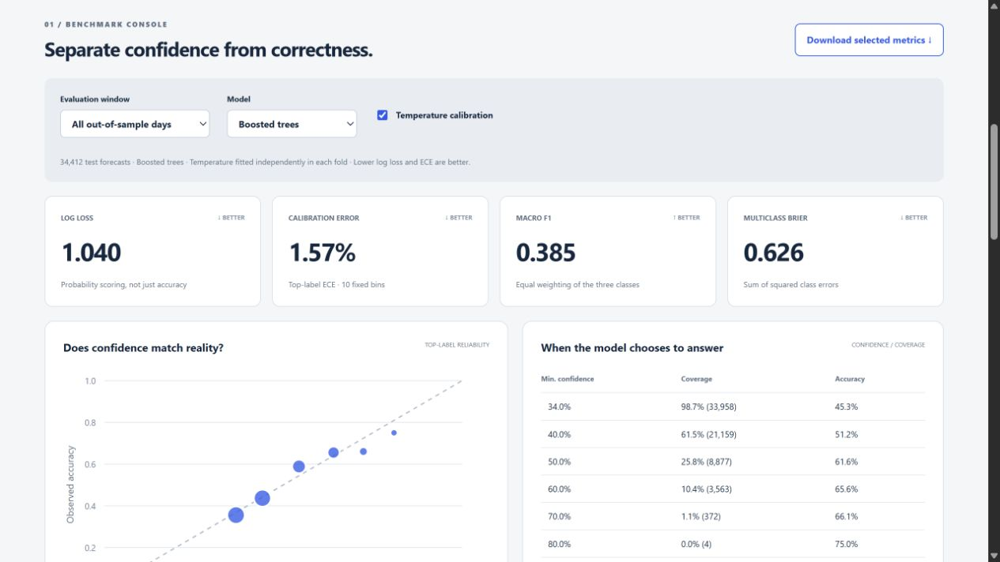

# TickLab — Market Probability Research

A reproducible financial time-series project built around dataset engineering, chronological benchmarking, probability calibration and monitoring—the research workflow emphasized in the [Alipes Machine Learning Researcher role](https://careers.alipes.dk/jobs/4881094-machine-learning-researcher).

**[Open the research console](https://ehsan-ch.github.io/tick-calibration-lab/)** · [Research notes](RESEARCH.md) · [CI checks](https://github.com/Ehsan-Ch/tick-calibration-lab/actions)



## Actual experiment

- **11,075,805** real ETHUSDT aggregate-trade records from Binance Vision, 1–14 January 2024.
- Streaming archive ingestion, publisher SHA256 verification, schema/order checks and causal 10-second bars.
- **20 features**, **3 expanding chronological folds**, **34,412 out-of-sample forecasts**.
- Training-prior baseline, incremental linear classifier and histogram boosted trees; temperature calibration fitted on separate days.
- Paired moving-block bootstrap intervals, reliability diagrams, confidence/coverage tables, drift review and a delayed-label replay.

| Model | Version | Test log loss ↓ | Top-label ECE ↓ | Macro F1 ↑ |
|---|---|---:|---:|---:|
| Historical prior | Raw | 1.0948 | 0.0265 | 0.1934 |
| Incremental linear | Raw | 2.1113 | 0.4707 | 0.1942 |
| Incremental linear | Calibrated | 1.1368 | 0.1463 | 0.1942 |
| Boosted trees | Raw | 1.0422 | 0.0156 | 0.3850 |
| Boosted trees | Calibrated | 1.0404 | 0.0157 | 0.3850 |

Calibrated boosted trees reduced pooled log loss by **4.97%** relative to the prior. The paired difference was −0.05436, with a within-day block-bootstrap 95% interval [−0.06212, −0.04744]. This small historical study does **not** establish generalization to equities or profitable execution. The linear model's failure and the small deterioration in boosted-tree ECE after calibration are retained in the report.

## Reproduce

Python 3.11 or 3.12 and Node 22+ are supported by the checks. From the repository directory:

```sh
python -m venv .venv
# Activate the environment using your platform's usual command.
python -m pip install -r requirements.txt
python -m ticklab.data
python -m ticklab.research
python verify_report.py
python -m unittest discover -s tests -p "test_*.py"
npm test
npm start
```

Open http://127.0.0.1:8796/. The preview serves `docs/`; GitHub Pages uses the same folder. No Node packages or API keys are needed. To inspect the saved report without downloading or retraining, run `verify_report.py`, the tests and `npm start` after installing Python requirements.

The acquisition step downloads roughly 160 MB of compressed archives (exact byte counts are in the manifest). It checks the publisher checksum and the repository's pinned hash. A revised source fails rather than silently replacing a pinned archive. Files in `data/raw/` and `data/cache/` are ignored. The published forecast archive contains derived probabilities and class labels, not raw trade prices.

## Evaluation contract

Each prediction uses only completed bars. The target is the last-trade-price log return 60 seconds later: down below −3 bps, up above +3 bps, flat otherwise. This is not a quote midpoint or an execution price. The first five minutes of each day and labels reaching its final boundary are excluded; stale endpoints are excluded too.

| Fold | Train | Select settings | Calibrate | Test |
|---|---|---|---|---|
| F1 | Jan 1–4 | Jan 5 | Jan 6 | Jan 7 |
| F2 | Jan 1–7 | Jan 8 | Jan 9 | Jan 10 |
| F3 | Jan 1–10 | Jan 11 | Jan 12 | Jan 13–14 |

All dates are UTC in 2024. Later folds may train on earlier evaluated days, as in an expanding historical experiment. The fold schedule, features, target and candidate settings were fixed before inspecting test results. Test observations do not overlap across folds. Adjacent 60-second labels within a day do overlap, so uncertainty is estimated in 10-minute blocks rather than treating each row as independent.

## Project map

| File | Purpose |
|---|---|
| `config.json` | Locked experiment specification |
| `ticklab/data.py` | Streaming source validation and aggregation |
| `ticklab/features.py` | Causal features, targets and overlap checks |
| `ticklab/research.py` | Selection, calibration, scoring and report generation |
| `ticklab/metrics.py` | Reliability, scoring, bootstrap and PSI |
| `verify_report.py` | Independent reconciliation from exported forecasts |
| `docs/data/report.json` | Full generated results and compact replay |
| `docs/data/predictions.csv.gz` | All 34,412 test forecasts, all model variants |
| `data/source_manifest.json` | Source URLs, byte counts and SHA256 pins |
| `reports/runtime.json` | Local timings, separate from the research result |

GitHub Actions checks Python 3.11/3.12, browser logic, source/config digests and all published scoring metrics without network data downloads. Full retraining is deliberately a separate command.

## Relevance and scope

The project demonstrates the role's full-stack research concerns: bounded-memory data preparation, numerical Python, time-series validation, calibration and benchmark infrastructure. It uses a public **crypto proxy**, not Alipes data or an equities dataset. No financial-news NLP model, order-book reconstruction, novel neural architecture or low-latency production system is claimed. [RESEARCH.md](RESEARCH.md) explains the gaps and next experiments.

Independent portfolio work by Ehsan Cheraghi. No affiliation with or endorsement by Alipes or Binance. Code is MIT; source data and derived research artifacts have separate non-commercial terms—see [DATA_LICENSE.md](DATA_LICENSE.md).
